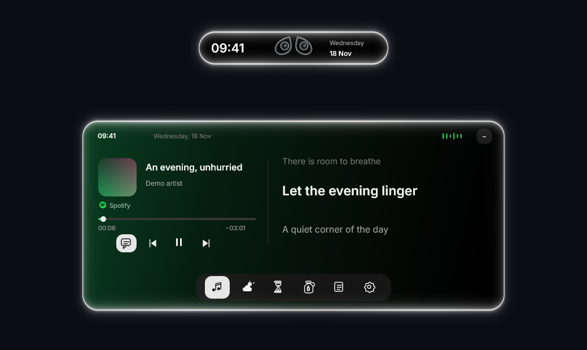
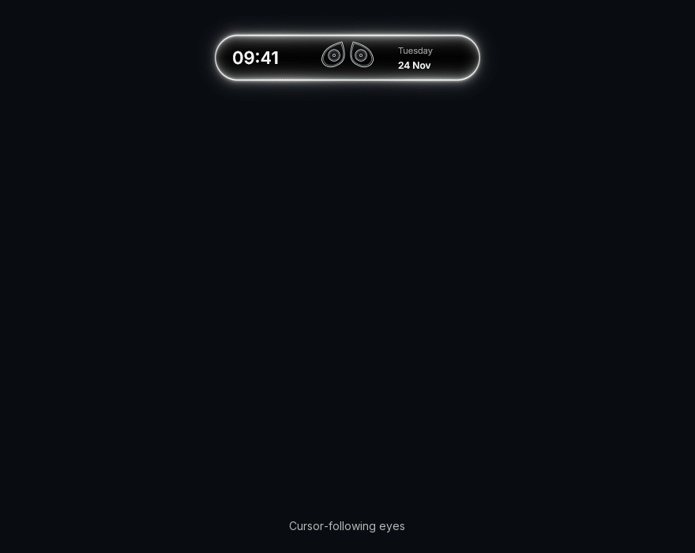
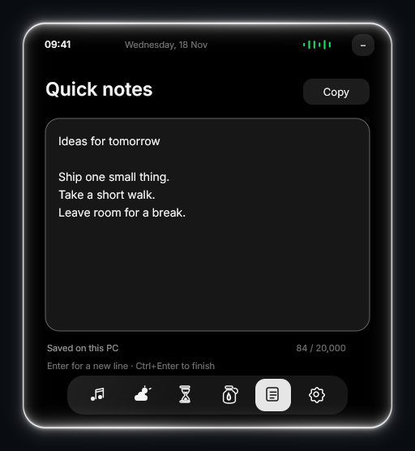
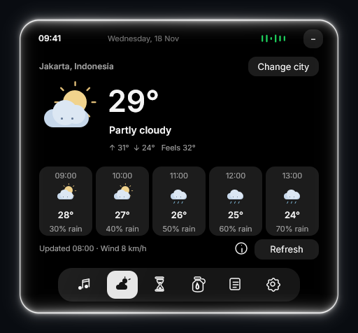
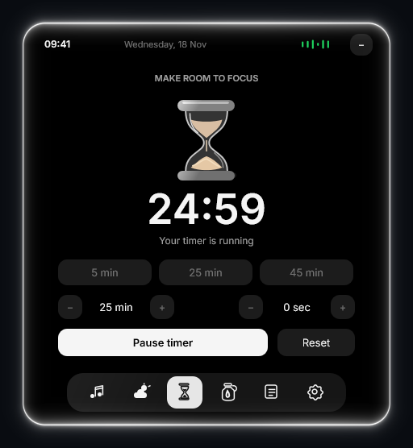
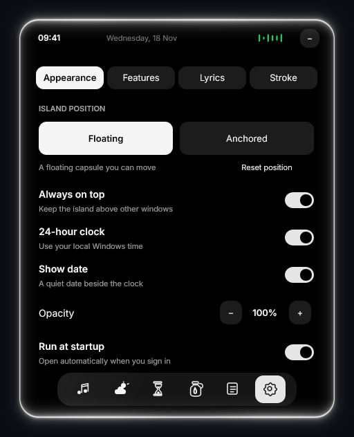

<div align="center">

# Dynamic Island For Windows

A native Windows desktop companion for music, weather, timers and quick notes.


[](https://github.com/kkornelius/Dynamic-Island-For-Windows/actions/workflows/ci.yml)

**[Download portable EXE](https://github.com/kkornelius/Dynamic-Island-For-Windows/releases/download/v0.7.2-beta.1/DynamicIslandForWindows-0.7.2-beta.1-windows-x64.exe)** · [Portable ZIP](https://github.com/kkornelius/Dynamic-Island-For-Windows/releases/download/v0.7.2-beta.1/DynamicIslandForWindows-0.7.2-beta.1-windows-x64.zip) · [Releases](https://github.com/kkornelius/Dynamic-Island-For-Windows/releases) · [Report a bug](https://github.com/kkornelius/Dynamic-Island-For-Windows/issues/new/choose)



</div>

## See it in motion

<p align="center"></p>

*GIF and screenshots are exported from the actual Direct2D renderer with fictional media, original sample lyrics, sample weather and notes. They illustrate UI states and transitions; they are not a live desktop recording or a capture of a Spotify account. [Reproduce the media](docs/BUILDING.md#reproduce-the-screenshots-and-gif).*

## Features

| Feature | Details |
|---|---|
| Music & lyrics | Windows media controls, artwork, system-audio visualizer and optional timed lyrics. |
| Weather | Current conditions and hourly forecasts for a selected city, with offline cache. |
| Timer | Countdown presets, pause/resume and an optional completion sound. |
| Water reminders | Check-ins, quiet hours, snooze, daily counter and a short drinking sound. |
| Quick notes | Local multiline notes with autosave, Unicode, clipboard, selection and undo/redo. |
| Appearance | Floating/anchored position, color wheel, glow, opacity and clock/date options. |
| Desktop awareness | Hover to expand, click to pin, fullscreen hiding and supported browser-tab avoidance. |
| Small interactions | Cursor-following eyes, blinking, proximity tears and Bluetooth device-type notices. |

<table>
<tr><th>Quick notes</th><th>Weather</th></tr>
<tr><td></td><td></td></tr>
<tr><th>Timer</th><th>Appearance</th></tr>
<tr><td></td><td></td></tr>
</table>

## Download & run

**Public beta · Windows 10 1809+ / Windows 11 · x64 · Portable**

1. Download the EXE above, or extract the ZIP.
2. Run the executable. Rust and Python are not needed to use the app.
3. Hover over the capsule to open it; click a dock icon to pin that panel.
4. Use **−** to collapse. Right-click the tray icon to quit.

The EXE embeds its font, sound and full third-party notices. Its C runtime is linked statically and the import table is checked for extra VC++ runtime dependencies. This is a portable application, not an installer.

**This beta is unsigned.** Windows may display a reputation warning. Verify the release's SHA-256 hashes and use this repository's downloads. This build has no signing/reputation guarantee.

### Startup, update and removal

- **Settings → Appearance → Run at startup** is opt-in. It creates a stable executable copy in `%LOCALAPPDATA%\DynamicIslandForWindows\app\` and registers it for the current Windows user.
- To update, quit the old instance first, then run the new build. Notes/preferences stay in their data directory.
- To remove, turn off startup, quit and delete the portable EXE. If startup was enabled, also remove the data directory's `app` subfolder. Keep the remaining data to retain Notes.

[Complete user guide](docs/USAGE.md)

## Engineering

Rust 2024, Win32 layered window, Direct2D/DirectWrite, Windows GSMTC/SMTC media sessions, WASAPI loopback RMS history, WinRT device enumeration and worker-based HTTPS requests.

- OS/network/file work uses workers and a message bus.
- Audio-only frames redraw the meter; other content follows its own deadlines.
- Glow geometry/lighting weights are reused across frames and recoloring.
- Notes use debounced, coalesced atomic writes and bounded undo history.
- A single-instance guard also handles automatic startup launches.

[Architecture](docs/ARCHITECTURE.md) · [Performance and measurement limits](docs/PERFORMANCE.md) · [Build/verification](docs/BUILDING.md)

Development was iterative and used AI-assisted tooling. Implementation choices and validation methods are documented alongside the demo.

## Build

On Windows x64, install current stable Rust/MSVC, Visual Studio C++ Build Tools and a Windows SDK:

```powershell
cargo build --release --locked
.\target\release\dynamic-island-for-windows.exe
```

```powershell
cargo fmt --all -- --check
cargo clippy --all-targets --locked -- -D warnings
cargo test --locked
python scripts/verify-portable.py target/release/dynamic-island-for-windows.exe
```

Python is only for optional developer/release tools. [Full instructions](docs/BUILDING.md).

## Privacy and beta limitations

Notes/preferences are local; Notes are plaintext. Audio levels are processed in memory, with no saved recordings or audio upload. Online lyrics start disabled and send track title, artist, album and duration to LRCLIB only after enabling. Weather sends city coordinates; searches send city text. No Spotify login is required. [Privacy details](docs/PRIVACY.md).

- Metadata, artwork and controls depend on Windows media-session support.
- Lyrics availability is separate from Spotify's catalog; some tracks have no timed result.
- Bluetooth notices depend on drivers; battery values are not invented.
- Timers stop when the app exits. Water check-ins do not measure intake.
- Full screen-reader support and keyboard navigation of every control are not implemented.
- Development testing used Windows 10; other hardware/display configurations still need testing.

## Credits and license

Project code: [MIT](LICENSE). [Contributing](CONTRIBUTING.md) · [Security](SECURITY.md) · [Changelog](CHANGELOG.md)

- [Inter](https://github.com/rsms/inter): The Inter Project Authors, [SIL OFL 1.1](assets/fonts/OFL.txt).
- Water sound: [“Gulp - Hard Swallow” by magnuswaker](https://freesound.org/people/magnuswaker/sounds/531755/), CC0 1.0, adapted into three gulps. [Provenance](assets/sounds/README.md).
- Weather: [Open-Meteo](https://open-meteo.com/), [CC BY 4.0 and sources](https://open-meteo.com/en/licence). Location data: [GeoNames](https://www.geonames.org/) via Open-Meteo. Values are rounded/formatted for display. The forecast info icon links to source credits.
- Lyrics lookup: [LRCLIB](https://lrclib.net/docs). Lyrics/artwork belong to their owners; public demo text/artwork is original sample data.
- [Embedded dependency notices](assets/licenses/NOTICES.txt), also accessible through `--licenses`.

The free Open-Meteo API is for non-commercial use and has limits. Review [its terms](https://open-meteo.com/en/terms) before commercial/higher-volume deployment. MIT does not replace third-party service/data terms.

Independent project; not affiliated with or endorsed by Apple, Microsoft or Spotify. Dynamic Island is a trademark of Apple Inc.; other names belong to their owners.
