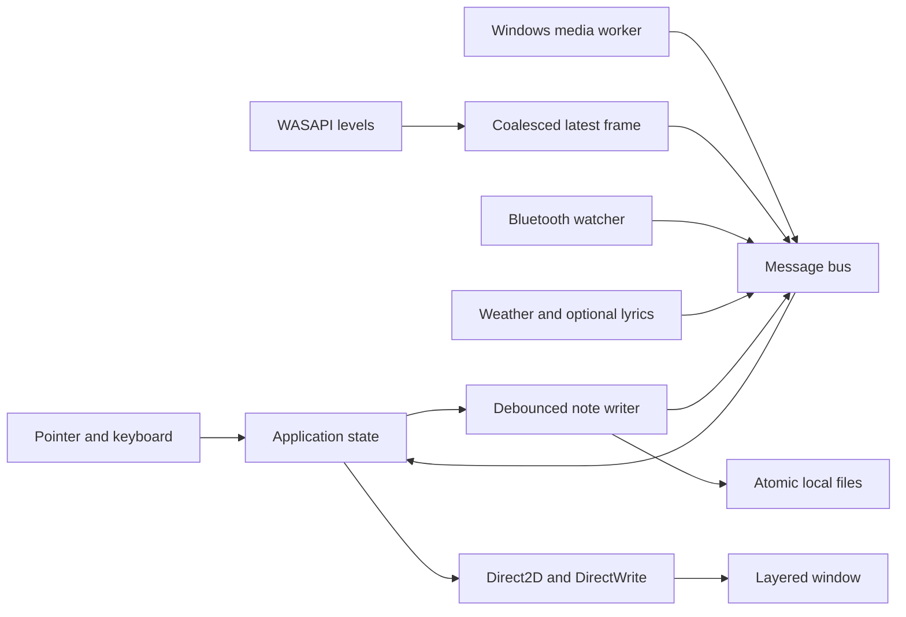

# Architecture

One Win32 layered window owns domain/UI state. Blocking work uses workers and a message bus.

| Module | Responsibility |
|---|---|
| `window.rs` | Message loop, workers, layout, interaction, surface presentation |
| `app_state.rs`, `interaction.rs`, `visibility.rs` | State, hover/pin rules and visibility transitions |
| `ui/` | Native rendering, hit regions, private font, reusable surfaces, vector icons/eyes |
| `media/` | GSMTC commands/metadata, artwork, audio levels, lyrics resolver/parser |
| `notes.rs` | Unicode editor, selection/undo, clipboard and lazy file writer |
| `timer.rs`, `reminders.rs` | Monotonic deadlines and reminder schedule |
| `weather.rs`, `network.rs` | Bounded HTTPS, city search, forecast and cache |
| `browser_space.rs`, `fullscreen.rs` | Window/control geometry and hiding decisions |
| `startup.rs`, `storage.rs`, `tray.rs` | Logon integration, persistence and tray |

## Rendering

Direct2D draws into a reusable DIB with DirectWrite text and private embedded Inter. The target currently uses software rendering; Windows handles desktop composition separately.

Text layouts, artwork and glow geometry are cached. Notes keep one replaceable layout rather than one per keystroke. Audio-only redraws clip to the meter; content epochs request full updates for other timed changes. Recoloring reuses shape/lighting data. Hidden overlays stop animation work.

Resize uses a 120 ms cubic ease. Browser hiding fades the already-masked surface rather than recompositing glow every frame. Eyes and icons are vectors.

## Workers and persistence

Audio overwrites a latest-frame slot and coalesces wake messages. Network/WinRT waits are bounded/cancellable. Notes use a 600 ms debounce and coalesced pending snapshots. File writes happen outside the UI thread; shutdown drains the newest snapshot. Atomic replacement protects previous files. Undo is limited to 32 snapshots.

Lyrics use Windows media metadata and a separate provider catalog, without a Spotify session cookie/password.

## Demo provenance

`--render-demo` shares native draw/mask code with the app and requires an isolated profile. Fictional lyrics, artwork, weather and Notes are generated locally. The Python tool composes those surfaces and checks decoded GIF frames against encoded source frames. This is a renderer demonstration, not desktop recording.
